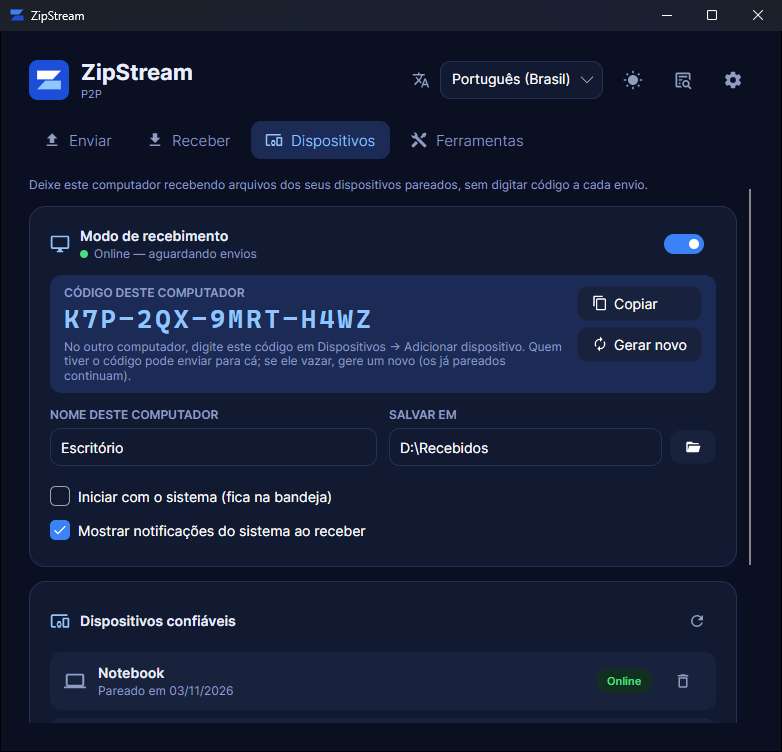
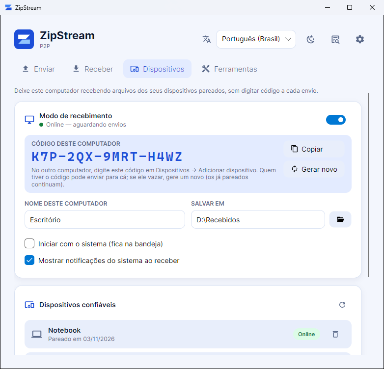
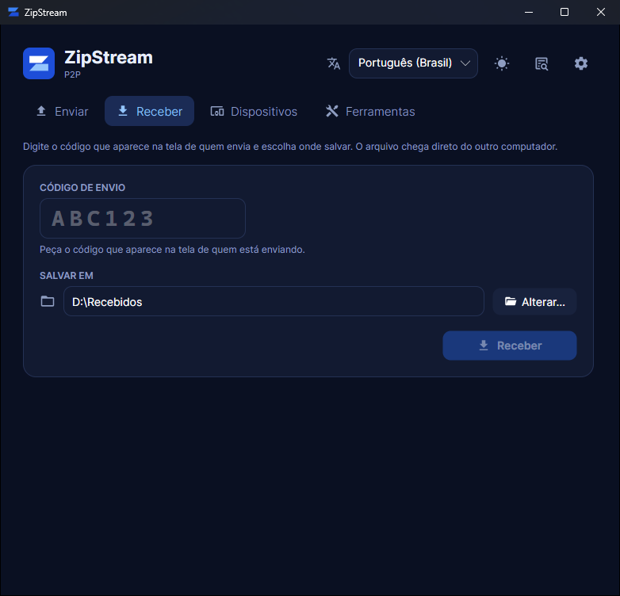

# ZipStream

Aplicativo desktop multiplataforma (Windows, Linux, macOS) para **compactar e transferir arquivos e pastas direto entre dois computadores (P2P)**, sem armazenar nada em nuvem e com **criptografia ponta a ponta (E2EE)**.

<p align="center">
  
  
</p>

## O que ele faz

- **Envia arquivos ou pastas** de qualquer tamanho: compacta em streaming (zstd), cifra e envia direto para o outro computador.
- **Código de envio** de 6 caracteres para parear os dois lados e **código de segurança (SAS)** para conferir que ninguém está no meio.
- **Modo de recebimento:** deixe um computador ligado recebendo dos seus dispositivos pareados, **sem digitar código a cada envio**. O pareamento é feito uma vez, com o código fixo do computador (`XXX-XXX-XXXX-XXXX`), e os arquivos chegam já extraídos na pasta escolhida.
- **Atualizações:** procura versões novas nas releases do GitHub; no Windows baixa, confere o SHA-256 e instala sozinho (o app fecha e reabre).
- **Retomada automática:** se a conexão cair, reconecta e continua de onde parou. Funciona inclusive depois de **fechar e reabrir o app** (lista "Envios/Recebimentos interrompidos" → **Retomar**).
- **Escolha onde salvar** ao receber (padrão: `Downloads`); nunca sobrescreve — usa `nome (1)`, `nome (2)`...
- **Menu de contexto** "Enviar com ZipStream" no gerenciador de arquivos (Windows; Linux e macOS em melhor esforço): abre só um painel compacto com o código **já copiado** para a área de transferência.
- **Fica na bandeja do sistema** (área de notificação no Windows/Linux, barra de menus no macOS): fechar a janela não interrompe transferências; **Sair** fica no menu do ícone. Uma única instância por usuário — novos pedidos vão para a que já está aberta.
- **Log técnico** com o que aconteceu em cada etapa (conexão, ICE, transferência, erros), com **Copiar** e **Exportar**.
- **Ferramentas:** compactar/descompactar `.zpp2` localmente, sem rede.
- Temas claro/escuro e idiomas en-US, pt-BR e es-ES.

## Como usar

### Enviar

1. Aba **Enviar** → arraste um arquivo ou pasta, ou use **Escolher arquivo** / **Escolher pasta**.
   (Ou clique com o botão direito no arquivo → **Enviar com ZipStream**: aparece um painel no canto da tela com o código já copiado.)
2. **Gerar código e enviar** → passe o **código de envio** para quem vai receber.
3. Quando o outro lado conectar, confira se o **código de segurança** é o mesmo nas duas telas.

### Receber

1. Aba **Receber** → digite o código de envio.
2. Em **Salvar em**, escolha a pasta (fica lembrada para as próximas vezes).
3. **Receber** → ao final, **Abrir pasta**.

### Modo de recebimento (sem código a cada envio)

Para um computador que fica ligado (ex.: o do escritório) receber arquivos dos seus outros computadores:

1. **No computador que recebe:** aba **Dispositivos** → ligue **Modo de recebimento** (fica "Online — aguardando envios"). Marque **Iniciar com o sistema** para ele já abrir na bandeja ao ligar o computador.
2. **No computador que envia (uma vez só):** aba **Dispositivos** → em **Código do outro computador**, digite o código que aparece no que recebe → **Adicionar dispositivo**. Os dois passam a confiar um no outro.
3. **Daí em diante:** aba **Enviar** → escolha o arquivo → em **Enviar para um dispositivo pareado**, escolha o computador → **Enviar**. Ele recebe sozinho e extrai em **Salvar em**.

- O código do computador é fixo; se vazar, **Gerar novo** invalida o antigo (os dispositivos já pareados continuam). Para tirar um dispositivo, **Remover** na lista.
- Só dispositivos da lista de confiáveis conseguem enviar; os outros são recusados antes de qualquer byte ser gravado.
- O ícone da bandeja tem **Modo de recebimento** para ligar/desligar sem abrir a janela.
- **Notificações do sistema** quando chega um arquivo, quando um dispositivo pareia ou quando um recebimento falha (desligáveis na aba Dispositivos). Windows: notificação nativa (balão da área de notificação, que no Windows 10/11 vira notificação do sistema); Linux: `notify-send`; macOS: `osascript`.
- **Enviar com ZipStream** (menu de contexto): com dispositivos pareados, a janela compacta pergunta o destino — **Gerar código e enviar** ou um dispositivo pareado. A janela pode ser movida (inclusive para outro monitor).

<p align="center"></p>

### Atualizações

⚙️ Configurações → **Atualizações**: versão instalada, **Verificar agora** e verificação automática (uma vez por dia, ao abrir). Com versão nova, aparece **Atualização disponível** no cabeçalho. No Windows, **Baixar e instalar** baixa o instalador da release, confere o SHA-256 publicado pelo GitHub e instala em modo silencioso, reabrindo o app no fim; no Linux e no macOS, **Ver novidades e downloads** abre a página da release. Builds locais (`0.0.0-dev`) não procuram atualizações.

### Se algo der errado

- O painel de status mostra uma explicação e o detalhe técnico; **Ver log** abre o log completo.
- Transferências interrompidas aparecem na aba correspondente com **Retomar** (os dois lados precisam retomar; o código é o mesmo).

## Arquitetura

```
[App Origem] ──DataChannel P2P (libdatachannel)── [App Destino]
      │                                              │
      └────── SignalR (sinalização) ────────────────┘
                        │
              [Servidor de sinalização]
              + coturn (TURN/STUN, fallback)
```

O servidor **só pareia** os dois lados (troca de SDP/candidatos ICE; no máximo 2 dispositivos por código). O arquivo vai **direto entre as máquinas** (ou via relay TURN quando o P2P direto é bloqueado), sempre cifrado com AES-256-GCM.

No modo de recebimento, o computador que recebe fica conectado ao hub e registra a **presença** assinando um desafio de uso único com a identidade dele (ninguém se registra como outro). Quem envia pede ao hub para **convidar** o dispositivo para uma sala nova, e daí em diante o fluxo é o mesmo. O hub não decide confiança: os dispositivos se autenticam entre si na sessão.

### Protocolo de transferência

Cada pacote `.zpp2` (zstd em chunks com SHA-256) é enviado em mensagens de até 60 KiB:

1. Troca de chaves ECDH P-256 → chave AES-256-GCM + código SAS.
2. *(Só entre pareados)* Cada lado envia, cifrada, a chave da **identidade permanente** (ECDSA P-256) e a assinatura das chaves efêmeras; o outro só continua se a identidade for confiável. Substitui a conferência do SAS e detecta quem se coloca no meio da sinalização.
3. Remetente envia o cabeçalho (id da transferência, nome, tamanho).
4. Destinatário responde com quantos bytes desse id já tem (**retomada**).
5. Remetente envia os chunks com **controle de fluxo** (no máximo 8 MB sem confirmação); o destinatário confirma (`Ack`) o que gravou em disco e, ao final, envia `Done`; o remetente responde `Done` e fecha primeiro.
6. Queda de conexão ou 30 s sem resposta → reconexão automática com backoff, retomando do último byte confirmado.

**Pareamento:** depois da troca de chaves, cada lado envia a identidade, o nome e um HMAC sobre a sessão com uma chave derivada do código do receptor (70 bits), provando que conhece o código **sem enviá-lo** — nem ao outro lado, nem ao servidor (que só vê um endereço derivado do código). Os dois só passam a confiar depois da confirmação do outro.

O estado das transferências em andamento fica em `%LOCALAPPDATA%/ZipStream/transfers` (Linux: `~/.local/share/ZipStream/transfers`; macOS: `~/Library/Application Support/ZipStream/transfers`).

## Projetos

| Projeto | Papel |
|---|---|
| `src/ZipP2P.Core` | Motor de compressão (zstd streaming, formato `.zpp2`) + criptografia (ECDH/AES-GCM/SAS, identidade do dispositivo, código do receptor) |
| `src/ZipP2P.P2P` | Transporte (libdatachannel), sinalização, presença, protocolo de transferência e pareamento, reconexão e estado persistido |
| `src/ZipP2P.Contracts` | DTOs e verificação de presença compartilhados (cliente/servidor) |
| `src/ZipP2P.Server` | Servidor de sinalização (ASP.NET Core + SignalR): salas, presença e convites |
| `src/ZipP2P.App` | Aplicativo desktop (Avalonia): modo de recebimento, dispositivos, atualizações |
| `tests/ZipP2P.Core.Tests` | Testes do motor e da criptografia |
| `tests/ZipP2P.P2P.Tests` | Protocolo, autenticação, pareamento, presença, retomada, reconexão e integração ponta a ponta via WebRTC |
| `tests/ZipP2P.App.Tests` | Modo de recebimento ponta a ponta, dispositivos, atualizações, iniciar com o sistema, log, linha de comando e menu de contexto |

## Requisitos

- .NET 10 SDK
- (opcional, para relay) Docker — para o coturn

## Como rodar

### Servidor de sinalização

```bash
dotnet run --project src/ZipP2P.Server
```

Escuta em `http://0.0.0.0:5000` (hub em `/signaling`). Para a mesma rede, também dá para usar o servidor **embutido no app**: ⚙️ Configurações → **Iniciar servidor local**.

### Aplicativo

```bash
dotnet run --project src/ZipP2P.App
```

Linha de comando:

| Argumento | Efeito |
|---|---|
| `--send <caminho>` | Abre o painel compacto e já começa a enviar (usado pelo menu de contexto) |
| `--receive <código>` | Abre a aba Receber com o código preenchido |
| `<caminho>` | Igual a `--send` |
| `--background` | Abre só na bandeja, sem a janela (usado por **Iniciar com o sistema**) |
| `--close-for-update` | Fecha de verdade a instância aberta, sem ir para a bandeja (usado pelo instalador); se não houver nenhuma, não abre o app |

As configurações ficam em SQLite (`%LOCALAPPDATA%/ZipStream/settings.db`) e são editadas em ⚙️ **Configurações**: URL do servidor, porta do servidor local, menu de contexto, atualizações. A pasta de destino é lembrada pela aba Receber. O mesmo banco guarda a identidade do dispositivo (no Windows, a chave privada fica cifrada com DPAPI), o código do receptor e os dispositivos confiáveis.

**Perfil separado:** a variável de ambiente `ZIPSTREAM_DATA_DIR` aponta o app para outra pasta de dados (configurações e transferências), com a própria instância — útil para simular um segundo computador na mesma máquina sem mexer no perfil real (ex.: `ZIPSTREAM_DATA_DIR=C:\temp\pc2`).

**Iniciar com o sistema** (aba Dispositivos): chave `Run` do usuário no Windows, `~/.config/autostart/zipstream.desktop` no Linux e `~/Library/LaunchAgents/com.zipstream.app.plist` no macOS — nada exige administrador.

## Testar na mesma rede (2 máquinas)

1. **Máquina A:** ⚙️ Configurações → **Iniciar servidor local** (mostra o endereço, ex.: `http://192.168.0.10:5000/signaling`).
2. **Máquina B:** ⚙️ Configurações → **URL do servidor** = endereço da máquina A → **Salvar**.
3. Uma máquina **Envia** (gera o código), a outra **Recebe** com o código.

## Instalação

Cada release (tag `v*`) gera pelo GitHub Actions:

| Arquivo | Sistema |
|---|---|
| `ZipStream-Setup-<versão>-win-x64.exe` | Windows — instalador (Inno Setup), por usuário, sem administrador; opção de já adicionar o menu de contexto |
| `zipstream_<versão>_amd64.deb` | Debian/Ubuntu/Mint — `sudo apt install ./zipstream_<versão>_amd64.deb`; instala em `/opt/zipstream`, atalho no menu e comando `zipstream` |
| `ZipStream-win-x64.zip`, `ZipStream-linux-x64.tar.gz`, `ZipStream-osx-x64.tar.gz` | Versões portáteis |

O instalador fecha o app aberto antes de copiar os arquivos (`--close-for-update`, detectado pelo mutex `ZipStreamAppMutex`); fechar a janela só manda o app para a bandeja, então sem isso o instalador ficava bloqueado. Versões até a 1.2.0 não têm o mutex: a primeira atualização a partir delas ainda pode pedir para fechar o app manualmente.

Para gerar uma release: `git tag v1.2.3 && git push origin v1.2.3`. Rodando o workflow manualmente (Actions → Release → *Run workflow*), os pacotes ficam nos artefatos da execução, sem criar release.

## Deploy do servidor (VPS com Docker)

`deploy/docker-compose.yml` sobe o servidor de sinalização e o coturn (TURN). O HTTPS fica com um reverse proxy que já rode na VPS (ex.: Caddy): o servidor entra na network externa `proxy` (`docker network create proxy`, se ainda não existir) com o alias `zipstream-server`. No Caddyfile, com o proxy também nessa network:

```
zipstream.seudominio.com {
	reverse_proxy zipstream-server:5000
}
```

```bash
git clone https://github.com/igoreusttaquio/ZipStream-P2P.git && cd ZipStream-P2P/deploy
cp .env.example .env            # PUBLIC_IP e TURN_PASSWORD
docker compose up -d --build    # atualizar: git pull && docker compose up -d --build
```

Firewall: liberar `3478/tcp+udp` e `49160-49200/udp` (80/443 já são do Caddy). Teste: `https://zipstream.seudominio.com` responde "ZipStream signaling server".

O modo de recebimento precisa do servidor com presença e convites: depois de atualizar o app, atualize também o servidor (`git pull && docker compose up -d --build`).

## Testar entre redes (TURN/relay)

1. Suba o servidor e o coturn (seção acima).
2. Nas duas máquinas, **URL do servidor** = `https://zipstream.seudominio.com/signaling`.
3. ⚙️ Configurações → **Servidor STUN/TURN**: host `zipstream.seudominio.com:3478`, usuário `zipstream` e a senha do `TURN_PASSWORD` → **Salvar**. Sem usuário, o servidor vale só como STUN. Sem nada configurado, o app usa o STUN público do Google (`stun.l.google.com:19302`), suficiente para a maioria das redes; o TURN só é necessário quando a conexão direta é bloqueada.

## Menu de contexto

⚙️ Configurações → **Menu de contexto** → **Instalar** / **Remover**.

| Sistema | Como é instalado | Observações |
|---|---|---|
| Windows | `HKCU\Software\Classes\*\shell` e `Directory\shell` (sem administrador) | No Windows 11 fica em "Mostrar mais opções" |
| Linux | Scripts do Nautilus e Caja, ação do Nemo, service menu do Dolphin | Melhor esforço; pode ser preciso reiniciar o gerenciador (`nautilus -q`) |
| macOS | Ação Rápida do Automator em `~/Library/Services` | Experimental; melhor com o app em /Applications |

Se o app mudar de lugar, Configurações mostra que a entrada aponta para outra cópia — é só clicar em **Instalar** de novo.

No Linux, o ícone da bandeja usa o protocolo StatusNotifierItem (KDE, Cinnamon, XFCE...); no GNOME é preciso a extensão *AppIndicator*. Sem bandeja, abrir o app de novo traz a janela de volta.

## Problemas comuns

- **"You must install or update .NET" ao abrir (rodando pelo código-fonte):** o app usa os runtimes `Microsoft.NETCore.App` **e** `Microsoft.AspNetCore.App` (servidor embutido). Instalar só o ASP.NET Core de uma versão mais nova que o .NET Runtime quebra a resolução — instale o .NET Runtime da mesma versão (`dotnet --list-runtimes` mostra o que há). Os pacotes do release já trazem o runtime.
- **"No precompiled XAML found":** build interrompido (ex.: compilar pela linha de comando com o app aberto pelo Visual Studio). Faça *Rebuild*.
- **Modo de recebimento fica em "Conectando ao servidor…":** o servidor configurado não responde ou ainda não tem presença/convites (atualize o servidor). O app tenta de novo sozinho, com espera crescente.
- **"Nenhum computador online com esse código":** o modo de recebimento está desligado no outro computador, ele aponta para outro servidor ou o código foi trocado (**Gerar novo**).

## Testes

```bash
dotnet test
```

Se o `dotnet test` abortar com "You must install or update .NET" (ASP.NET Core mais novo que o .NET Runtime, ver acima), dá para usar o runtime que vem com o Visual Studio:
`dotnet test -- "RunConfiguration.DotNetHostPath=C:\Program Files\Microsoft Visual Studio\18\Professional\dotnet\net10.0\runtime\dotnet.exe"`.

## Roadmap (resumido)

- [x] Compressão/descompressão em streaming (arquivos e pastas)
- [x] Transferência P2P + sinalização
- [x] E2EE (ECDH + AES-GCM) + SAS
- [x] Arquivos grandes (controle de fluxo + confirmação)
- [x] Retomada automática e após reabrir o app
- [x] Log técnico, menu de contexto, escolha da pasta de destino
- [x] Tela para servidor STUN/TURN
- [x] Teste com coturn real
- [x] Envio começa enquanto compacta (sem esperar a compressão terminar)
- [x] Modo de recebimento: pareamento por código fixo, envio sem código, iniciar com o sistema
- [x] Atualização pelo app (releases do GitHub) e "close for update" no instalador
- [x] Nova identidade visual (logo, paleta clara/escura)
- [x] Notificações nativas do modo de recebimento
- [ ] Instalador Windows assinado
- [x] Deploy do servidor em produção (Docker + HTTPS via Caddy)
- [x] Empacotamento do app (instalador Windows e .deb)
- [ ] Monetização

Detalhes no [`plan.md`](plan.md).
